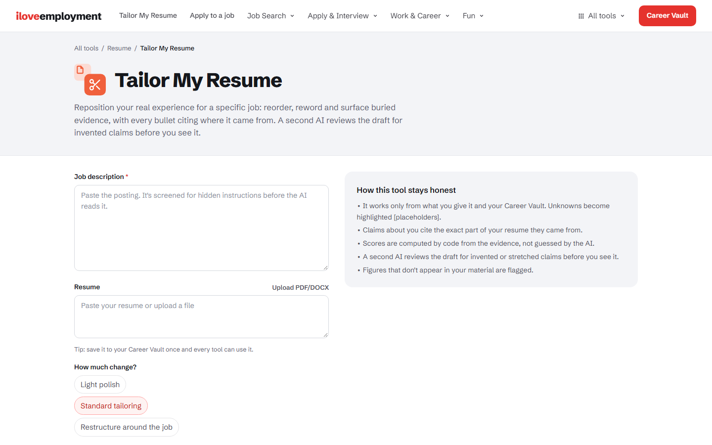
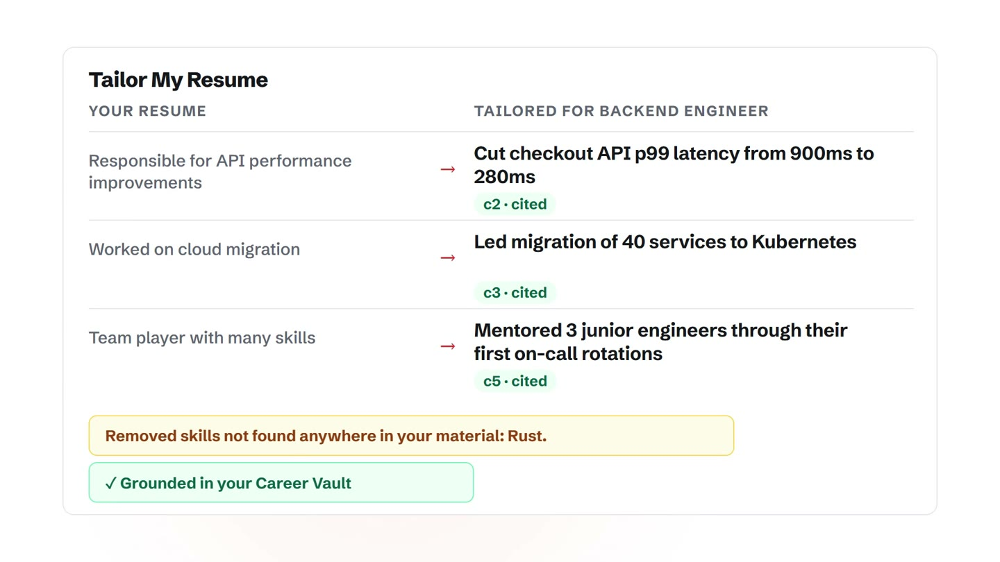
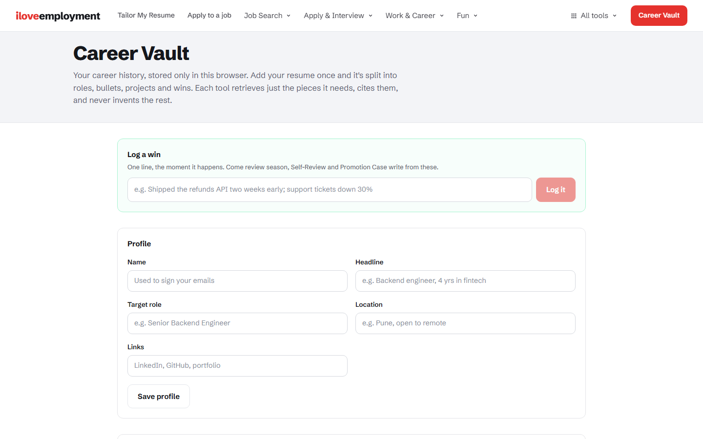

# iloveemployment

iLovePDF, but for your career: 46 focused tools for every step of a job search, and one rule behind all of them. Nothing about you gets invented.

[](https://github.com/PranavJha-3000/IloveEmployement/actions/workflows/ci.yml)


Add your resume once and it becomes a Career Vault in your browser. Every tool then writes from it: it reads the posting or the situation, drafts the output, and cites the part of your resume each claim came from. Lines that can't be traced are flagged, and invented skills and figures are removed or called out before you see them.

It's for people who want to move fast without sounding like a template. A free account gets one run a day on a hosted model, and you can bring your own key from nine providers for unlimited runs. Your resume and vault stay in your browser either way. [Privacy](#privacy) says what goes where.

**Get started:** use the [live site](https://iloveemployment.vercel.app), or [run it locally](#run-it-locally) in a few minutes. To host your own copy with accounts and the free tier, see [Deploying](#deploying).

## Demo

[](.github/images/demo.gif)

The tool grid, the Tailor My Resume form, and a live rewrite where each new bullet carries a citation chip and a skill that appears nowhere in the source is removed. The resume content is fictional.

## Features

- **Career Vault:** your resume, projects and wins, chunked by role and bullet and stored in IndexedDB. Import a PDF, Word or text resume, review the extracted profile, and confirm it. Export, import or delete everything at any time.
- **46 tools, one page each:** Find jobs, Resume, Reach out, Interview, Offer, Join and leave, At work, Grow, and Just for fun. See [the tools](#the-tools).
- **Never invents experience:** generated lines cite vault chunks by id. Fake citations are dropped, figures that aren't in your material are flagged, and skills that appear nowhere in your source are stripped.
- **Computed scores:** the model classifies evidence; code turns that into fit scores, verdicts, ATS coverage and offer math, with the formula shown.
- **Reviewed drafts:** resumes and cover letters get a second, adversarial AI pass for invented claims, then one revision if it finds anything serious.
- **Free trial, then your key:** sign in with an email code for one free run a day on Groq, with Gemini as an automatic fallback when a quota runs out. Bring your own key for unlimited runs. A paid plan is planned, see [Roadmap](#roadmap).
- **Apply to this job:** an agent runs fit check, tailor, cover letter and outreach as a policy-driven loop. A SKIP verdict stops it, step budgets are enforced, and runs can be resumed. It needs your own key.
- **Shows its work:** every result has a "How this was generated" panel with the context blocks sent, the playbooks used, the review verdict and the run trace.

## Screenshots

| Tailor My Resume | A cited rewrite |
|---|---|
|  |  |

| Career Vault |
|---|
|  |

The result image is a recreation of the result view with fictional resume content, not a live capture.

## The tools

| Stage | Tools |
|---|---|
| **Target** | Job Fit Check · JD Decoder · Skill Gap Plan |
| **Resume & Profile** | Tailor My Resume · ATS Check · Proof Check (live GitHub) · Bullet Point Fixer · Cover Letter · LinkedIn Optimizer |
| **Outreach** | Cold Recruiter Message · Referral Request · Follow-up Email · Interview Thank-You Note · Rejection Reply |
| **Interview** | Interview Prep Pack · Mock Interview · STAR Story Builder · Tell Me About Yourself · Salary Expectations Answer · Interview Debrief |
| **Offer** | Offer Comparator · Salary Negotiation · Accept an Offer · Decline an Offer |
| **Join & Leave** | Resignation Letter (with rage filter) · Notice Period & Joining Date · Reference Request · Internship Conversion Ask · Gap & Layoff Explainer |
| **At Work** | Email Tone Fixer · Leave Application · Corporate Speak Translator · HR Concern Write-up · New Job Intro · 1:1 Agenda · 30-60-90 Day Plan · Status Update |
| **Growth** | Self-Review Writer · Promotion Case · Ask for a Raise · Peer Feedback · Career Switch Pitch |
| **Fun** | Resume Roast (Rizz Score, Skill Issue, ATS Boss Fight modes) · Resume Court · Employment Aura · Corporate Bingo |

Each tool has its own page at `/tools/<slug>`, but they are all configurations of six engines (Message, Match, Tailor, Interview, Offer, Fun). Adding a tool is a preset of about 30 lines, not a new page and API route.

## How it works

```mermaid
flowchart LR
  subgraph Browser["Browser (local-first)"]
    V[(Career Vault<br/>IndexedDB)] --> R[Hybrid retrieval<br/>BM25 + on-device embeddings, RRF]
    R -->|top-k chunks only| REQ
    F[Tool form] --> REQ[POST /api/run/:preset]
  end
  subgraph Server["Server (stateless)"]
    REQ --> A[Access<br/>BYOK, or signed-in free run<br/>Groq, Gemini fallback]
    A --> G[Injection gate<br/>pasted JDs and emails]
    G --> K[Knowledge retrieval<br/>curated playbooks, BM25]
    K --> C[Context assembler<br/>token budgets, fenced untrusted data]
    C --> M[Structured generation<br/>zod schema per tool]
    M --> RV{Reviewer pass?}
    RV -->|issues| REV[Revise once]
    RV -->|clean| FIN
    REV --> FIN[Finalize in code<br/>scores, verdicts, offer math,<br/>quote and citation checks]
    FIN --> GR[Grounding check<br/>fake citations, invented figures]
  end
  GR --> UI[Result + citations +<br/>'How this was generated']
```



### Access and the free trial

| Request | What happens |
|---|---|
| Your own API key | Runs on your key, unlimited. The key is used for that call only and is never stored. No sign-in needed. |
| No key, signed in | Runs on the server's Groq key (`openai/gpt-oss-120b`). One run per user per UTC day. If Groq is rate limited or out of quota, the same request retries on Gemini. |
| No key, signed out | Refused with a prompt to sign in. No model call is made. |
| A run that fails | Refunded. Bad input or a provider error doesn't use up your daily run. |

Sign-in is an emailed code through Supabase Auth. The daily counter is one atomic SQL function (`supabase/schema.sql`), so two simultaneous requests can't both take the last run. If Supabase isn't configured, the app falls back to a per-IP counter, which is fine for local development.

### AI engineering highlights

| Technique | Where | What it does |
|---|---|---|
| **RAG over personal data** | `lib/vault/*` | Structure-aware chunking (role, then bullet), retrieval in the browser; only the top-k chunks for the task are sent. Whole-resume tools keep document order. |
| **Hybrid retrieval** | `lib/retrieval/*`, `lib/vault/embeddings.ts` | BM25 fused with all-MiniLM-L6-v2 embeddings (Transformers.js, on-device) via Reciprocal Rank Fusion. Finds "reduced lead time" for "ship faster". |
| **Knowledge-base RAG** | `lib/kb/*` | 37 curated playbooks (negotiation, ATS, India notice periods and CTC, STAR, equity, HR write-ups) retrieved per tool by tag and BM25. |
| **Context engineering** | `lib/engine/context.ts` | Priority-ordered blocks with per-block token caps and a global budget; the manifest is shown to the user. |
| **Structured outputs** | `lib/engine/reports.ts` | A zod schema per report kind via `generateObject`, with a plain-JSON fallback for providers without structured output. |
| **Deterministic scoring** | `lib/engine/scoring.ts` | Fit scores, verdicts, ATS keyword coverage, interview answer signals and all offer math are code. |
| **Grounding verification** | `lib/engine/grounding.ts`, finalizers | Citations must resolve to supplied chunks; figures must appear in the user's material; roast, court and red-flag quotes must be verbatim. |
| **Prompt-injection defence** | `lib/engine/injection.ts` | Strips invisible and bidi characters, flags instruction-shaped lines, fences pasted text as untrusted data. |
| **Drafter, then reviewer** | `lib/engine/review.ts` | An adversarial second pass on resumes and cover letters; one revision if it finds anything serious. |
| **Provider failover** | `lib/engine/run.ts`, `lib/engine/access.ts` | Free-tier calls switch from Groq to Gemini on quota or overload errors only. Other errors don't switch. |
| **Document intelligence** | `lib/profile/*`, `lib/skills/*` | A resume becomes a typed profile: a deterministic extractor plus optional model refinement, with confidence computed in code and a skill taxonomy that maps aliases ("JS") to canonical names. |
| **Evals** | `evals/*`, [`evals/RETRIEVAL.md`](evals/RETRIEVAL.md), [`evals/PROFILE.md`](evals/PROFILE.md) | Retrieval strategies scored on a labelled set with bootstrap confidence intervals; profile extraction scored field by field on 13 resumes; both gated in CI. An LLM-judge harness with 28 golden cases is built, and its first full run is pending. |
| **Tests** | `tests/*` | 520 tests: deterministic engine, access and failover, prompt lint over every tool, retrieval, agent and profile units, plus full-pipeline runs against a scripted model. No key needed. |

## Run it locally

```bash
git clone https://github.com/PranavJha-3000/IloveEmployement.git && cd IloveEmployement && npm install && npm run dev
```

Open [localhost:3000](http://localhost:3000). With no environment variables, every tool works with your own API key. To offer the free trial, copy `.env.example` to `.env.local` and fill in what you need:

| Variable | Purpose |
|---|---|
| `FREE_TIER_PROVIDER`, `FREE_TIER_API_KEY`, `FREE_TIER_MODEL` | Server key for keyless visitors. Use `groq` with a free key from [console.groq.com](https://console.groq.com/keys). |
| `FREE_TIER_FALLBACK_PROVIDER`, `FREE_TIER_FALLBACK_API_KEY`, `FREE_TIER_FALLBACK_MODEL` | Optional second provider, for example `google` with a free [Gemini key](https://aistudio.google.com/apikey). Used when the first is out of quota. |
| `FREE_TIER_DAILY_LIMIT` | Free runs per user per day (default 1). |
| `NEXT_PUBLIC_SUPABASE_URL`, `NEXT_PUBLIC_SUPABASE_PUBLISHABLE_KEY` | Your Supabase project, for email-code sign-in. The publishable key is safe to expose. |
| `SUPABASE_SERVICE_ROLE_KEY` | Server-only secret key for the daily counter. Never prefix it with `NEXT_PUBLIC_`. |
| `UPSTASH_REDIS_REST_URL`, `UPSTASH_REDIS_REST_TOKEN` | Shared rate limiting for the no-Supabase fallback (in-memory otherwise). |
| `GITHUB_TOKEN` | Optional: raises the GitHub API limit for Proof Check. |

Without the Supabase variables, sign-in is off and the free tier falls back to a per-IP counter.

## Deploying

Everything runs on free tiers: Vercel (hobby), Groq, Gemini and Supabase.

1. **Supabase:** create a project, then run [`supabase/schema.sql`](supabase/schema.sql) in the SQL editor. Under Authentication, enable the Email provider and paste [`supabase/email-templates/sign-in-code.html`](supabase/email-templates/sign-in-code.html) into both the Magic Link and Confirm signup templates so emails contain a code (its first line gives the subject). Set the Site URL to your deployed address.
2. **Vercel:** import the repo and add the environment variables from the table above. The secret key and the Groq and Gemini keys go in as server-side variables only.
3. **Email sending:** Supabase's built-in sender allows only a few emails an hour. Before real traffic, add a free SMTP service such as Resend under Authentication, SMTP settings.

## Documentation

- [`platform.md`](platform.md): architecture notes.
- [`docs/RESTRUCTURE_PLAN.md`](docs/RESTRUCTURE_PLAN.md): why the app is built on engines and presets, and what was deleted.
- [`docs/superpowers/plans/2026-11-09-groq-free-trial-accounts.md`](docs/superpowers/plans/2026-11-09-groq-free-trial-accounts.md): the plan behind the free trial, sign-in and failover.
- [`evals/RETRIEVAL.md`](evals/RETRIEVAL.md) and [`evals/PROFILE.md`](evals/PROFILE.md): evaluation reports.

## Known limitations

- **One free run a day.** A reviewed tool (resume, cover letter) makes up to three model calls but counts as one run.
- **The agent workflow needs your own key.** It makes many model calls per run, so it isn't on the free tier.
- **Free-tier quotas are shared.** Groq and Gemini free quotas are per project, not per user. If both run out, everyone sees the rate-limit message until they reset.
- **Fallback is per call.** A reviewed run can have its draft on Groq and its review on Gemini, and the result's model label names the first provider.
- **Free-tier providers may use prompts for model improvement.** Check Groq's and Google's terms before sending anything sensitive; with your own key, your own provider terms apply.
- **One account per email, not per person.** Nothing stops someone signing up with several addresses.
- **LLM-judge evals have not been run in full yet.** The harness is built and the retrieval and profile gates run in CI.

## Privacy

- **Your vault lives in your browser** (IndexedDB). Export, import or delete it any time. Each run sends only the chunks it needs.
- **Embeddings are computed on your device.** Your text is never sent anywhere to be embedded.
- **Your own API key** is used for that call only. It lives in `sessionStorage`, is cleared when the tab closes, and is never stored on the server.
- **Accounts hold an email address and a daily run count.** That's all. No resume, vault or generated text is stored on the server.
- No analytics, no tracking. Run traces, if you enable export, contain counts and names only, never user text.

## Security

- API-key-like strings are redacted from errors and logs.
- Pasted text (job posts, emails) passes an injection gate and is fenced as untrusted data.
- The Supabase counter table has row-level security on and no policies; only the server's secret key can call the counter functions. The publishable key is denied.
- Bearer tokens are verified with Supabase on every free-tier request, and an unreachable Supabase blocks the run instead of allowing it.

## Development

```bash
npm run typecheck
npm test                         # 520 tests, no network
npm run eval:retrieval -- --ci   # retrieval regression gate, offline; report in evals/RETRIEVAL.md
npm run eval:profile -- --ci     # profile extraction accuracy gate, offline; report in evals/PROFILE.md
npm run eval -- --dry            # list the 28 golden cases
npm run eval -- --agent --dry    # list the 4 agent workflow cases
npm run eval -- --models google:<model> --judge google:<model>   # key from .env (EVAL_* or FREE_TIER_*)
```

CI (`.github/workflows/ci.yml`) runs typecheck, tests, the retrieval and profile eval gates, and the build on every push and PR. LLM evals run on demand (`evals.yml`) with an `EVAL_API_KEY` secret.

### Add a tool

Most tools are a preset in `lib/presets/*.ts`: fields, knowledge tags, what to retrieve from the vault, and the instruction. For example:

```ts
{
  id: "thank-you-note",
  slug: "interview-thank-you-note",
  engine: "message",
  category: "outreach",
  name: "Interview Thank-You Note",
  fields: [company(), role(), area("discussed", "What did you talk about?", { required: true })],
  kbTags: ["thank-you", "interview"],
  usesVault: true,
  vaultQuery: (i) => i.discussed,
  format: "email",
  task: () => "Write a thank-you under ~150 words that references one specific thing from the conversation…",
}
```

The card, nav entry, SEO page, validation, retrieval, injection gate, grounding and rendering come from the engine. `tests/prompts.test.ts` lints every preset: unique ids, real knowledge tags, a substantive instruction, and no instruction that invites invention. Structured reports add a zod schema and a finalizer in `lib/engine/reports.ts`.

## Roadmap

- **Paid plan:** a subscription for a higher daily limit and the agent workflow. The daily-run function already takes the limit as a parameter, so a plan only needs to pass a bigger number.
- Sign in with Google.
- First full LLM-judge eval run and `evals/LLM.md`.

## Stack

Next.js 15 (App Router) · React 19 · TypeScript · Tailwind v4 · Vercel AI SDK (9 providers) · Groq and Gemini free tiers · Supabase Auth and Postgres · zod · Transformers.js · IndexedDB · Node test runner · GitHub Actions

## License

[MIT](LICENSE). Contributions welcome: see [CONTRIBUTING.md](CONTRIBUTING.md).
