# iloveemployment

**iLovePDF, but for your career.** 46 focused tools for every step of a job, from reading a posting to negotiating the offer to writing the resignation letter, built on one rule: **nothing about you gets invented.**

**Live:** [iloveemployment.vercel.app](https://iloveemployment.vercel.app) · free daily runs, no sign-up · or bring your own key from 9 providers

---

## Why it exists

Job seekers don't lack AI generators. They lack time and trust. Tailoring one application takes hours, and generic AI text is easy for recruiters to spot, and it often invents experience. iloveemployment fixes both:

- **Add your resume once.** It becomes a **Career Vault** in your browser, and every tool writes from it.
- **Every claim about you is traced.** Generated lines cite the exact part of your resume they came from. Lines that can't be traced are flagged, and invented skills and figures are removed or called out before you see them.
- **Scores are computed, not vibes.** The model classifies evidence; code turns that into scores and verdicts with the formula shown.

## The tools

| Stage | Tools |
|---|---|
| **Target** | Job Fit Check · JD Decoder · Skill Gap Plan |
| **Resume & Profile** | Tailor My Resume · ATS Check · Proof Check (live GitHub) · Bullet Point Fixer · Cover Letter · LinkedIn Optimizer |
| **Outreach** | Cold Recruiter Message · Referral Request · Follow-up Email · Interview Thank-You Note · Rejection Reply |
| **Interview** | Interview Prep Pack · Mock Interview · STAR Story Builder · Tell Me About Yourself · Salary Expectations Answer · Interview Debrief |
| **Offer** | Offer Comparator · Salary Negotiation · Accept an Offer · Decline an Offer |
| **Join & Leave** | Resignation Letter (with rage filter) · Notice Period & Joining Date · Reference Request · Internship Conversion Ask · Gap & Layoff Explainer |
| **At Work** | Email Tone Fixer · Leave Application · Corporate Speak Translator · HR Concern Write-up · New Job Intro · 1:1 Agenda · 30-60-90 Day Plan · Status Update |
| **Growth** | Self-Review Writer · Promotion Case · Ask for a Raise · Peer Feedback · Career Switch Pitch |
| **Fun** | Resume Roast (Rizz Score, Skill Issue, ATS Boss Fight modes) · Resume Court · Employment Aura · Corporate Bingo |

Each tool has its own page at `/tools/<slug>`, but they're all **configurations of six engines** (Message, Match, Tailor, Interview, Offer, Fun). Adding a tool is a ~30-line preset, not a new page and API route.

## How it works

```mermaid
flowchart LR
  subgraph Browser["Browser (local-first)"]
    V[(Career Vault<br/>IndexedDB)] --> R[Hybrid retrieval<br/>BM25 + on-device embeddings, RRF]
    R -->|top-k chunks only| REQ
    F[Tool form] --> REQ[POST /api/run/:preset]
  end
  subgraph Server["Server (stateless)"]
    REQ --> A[Access<br/>free tier or BYOK, rate limit]
    A --> G[Injection gate<br/>pasted JDs and emails]
    G --> K[Knowledge retrieval<br/>curated playbooks, BM25]
    K --> C[Context assembler<br/>token budgets, fenced untrusted data]
    C --> M[Structured generation<br/>zod schema per tool]
    M --> RV{Reviewer pass?}
    RV -->|issues| REV[Revise once]
    RV -->|clean| FIN
    REV --> FIN[Finalize in code<br/>scores, verdicts, offer math,<br/>quote and citation checks]
    FIN --> GR[Grounding check<br/>fake citations, invented figures]
  end
  GR --> UI[Result + citations +<br/>'How this was generated']
```



### AI engineering highlights

| Technique | Where | What it does |
|---|---|---|
| **RAG over personal data** | `lib/vault/*` | Structure-aware chunking (role → bullet), retrieval in the browser; only the top-k chunks for the task are sent. Whole-resume tools keep document order. |
| **Hybrid retrieval** | `lib/retrieval/*`, `lib/vault/embeddings.ts` | BM25 fused with all-MiniLM-L6-v2 embeddings (Transformers.js, runs on-device) via Reciprocal Rank Fusion. Finds "reduced lead time" for "ship faster". |
| **Knowledge-base RAG** | `lib/kb/*` | 37 curated playbooks (negotiation, ATS, India notice periods and CTC, STAR, equity, HR write-ups…) retrieved per tool by tag + BM25. |
| **Context engineering** | `lib/engine/context.ts` | Priority-ordered blocks with per-block token caps and a global budget; the manifest is shown to the user. |
| **Structured outputs** | `lib/engine/reports.ts` | A zod schema per report kind via `generateObject`, with a fallback for providers without structured output. |
| **Deterministic scoring** | `lib/engine/scoring.ts` | Fit scores, verdicts, ATS keyword coverage and parsing checks, interview answer signals and all offer math are code. |
| **Grounding verification** | `lib/engine/grounding.ts`, finalizers | Citations must resolve to supplied chunks; figures must appear in the user's material; roast/court/red-flag quotes must be verbatim; GitHub repos must have been fetched. |
| **Prompt-injection defence** | `lib/engine/injection.ts` | Strips invisible/bidi characters, flags instruction-shaped lines, fences pasted text as untrusted data. |
| **Drafter → reviewer** | `lib/engine/review.ts` | An adversarial second pass on resumes and cover letters; one revision if it finds anything serious. |
| **Write-back memory** | STAR Builder, wins log | Stories and wins saved to the vault are retrieved by every other tool. |
| **Retrieval evaluation** | `evals/retrieval/*`, [`evals/RETRIEVAL.md`](evals/RETRIEVAL.md) | A labelled retrieval set scores keyword, embedding and hybrid strategies (recall, MRR, nDCG) with bootstrap confidence intervals. A decision rule committed before measuring rejected the cross-encoder reranker (no gain, over the latency budget), so none ships. CI gates the keyword baseline. |
| **Agent workflow** | `/apply`, `lib/agent/*` | "Apply to this job" runs fit check, tailor, cover letter and outreach as a policy-driven loop. A SKIP verdict stops it, step budgets are enforced, and runs are saved so they can be resumed. |
| **Document intelligence** | `lib/profile/*`, `lib/skills/*`, `components/vault/*` | A resume becomes a typed profile: a deterministic extractor plus optional model refinement, with confidence computed in code. You review and confirm it; a skill taxonomy maps aliases ("JS") to canonical names for fit and ATS scoring. Confirming saves a base resume version; tailored versions record the targeted job and can be compared in a diff. |
| **Profile extraction eval** | `evals/profile/*`, [`evals/PROFILE.md`](evals/PROFILE.md) | Field-level precision and recall of the extractor against 13 labelled resumes, gated in CI. |
| **LLM evals** | `evals/llm/*`, `evals/LLM.md` (pending) | 28 golden cases across the six engines plus 4 agent cases, scored against a real model with an LLM judge. The harness is built; `evals/LLM.md` does not exist yet because the first full run is still pending. |
| **Tests** | `tests/*` | 495 tests: deterministic engine, retrieval, agent and profile units plus full-pipeline runs against a scripted model. No key needed. |

## Privacy

- **Your vault lives in your browser** (IndexedDB). Export, import or delete it any time. Each run sends only the chunks it needs.
- **Embeddings are computed on your device.** Your text is never sent anywhere to be embedded.
- **Bring-your-own-key** requests use your key for that call only; it's never stored server-side (it lives in `sessionStorage`, cleared when the tab closes).
- No accounts, no analytics, no tracking.

## Run it locally

```bash
git clone https://github.com/PranavJha-3000/IloveEmployement.git
cd IloveEmployement
npm install
npm run dev
```

Open [localhost:3000](http://localhost:3000). With no environment variables, every tool works with your own API key. To offer the free tier, copy `.env.example` to `.env.local`:

| Variable | Purpose |
|---|---|
| `FREE_TIER_PROVIDER`, `FREE_TIER_API_KEY`, `FREE_TIER_MODEL` | Server key for keyless visitors (e.g. `google` / `gemini-3.5-flash-lite`) |
| `FREE_TIER_DAILY_LIMIT` | Runs per IP per day (default 15) |
| `UPSTASH_REDIS_REST_URL`, `UPSTASH_REDIS_REST_TOKEN` | Shared rate limiting across serverless instances (in-memory otherwise) |
| `GITHUB_TOKEN` | Optional: raises the GitHub API limit for Proof Check |

## Quality

```bash
npm run typecheck
npm test                      # 495 tests, no network
npm run eval:retrieval -- --ci   # retrieval regression gate, offline; report in evals/RETRIEVAL.md
npm run eval:profile -- --ci     # profile extraction accuracy gate, offline; report in evals/PROFILE.md
npm run eval -- --dry         # list the 28 golden cases
npm run eval -- --agent --dry # list the 4 agent workflow cases
npm run eval -- --models google:<model> --judge google:<model>   # key from .env (EVAL_* or FREE_TIER_*), writes evals/LLM.md (first full run still pending)
```

CI (`.github/workflows/ci.yml`) runs typecheck, tests, the retrieval and profile eval gates and build on every push and PR. Evals run on demand (`evals.yml`) with an `EVAL_API_KEY` secret.

## Add a tool

Most tools are a preset in `lib/presets/*.ts`: fields, knowledge tags, what to retrieve from the vault, and the instruction. For example:

```ts
{
  id: "thank-you-note",
  slug: "interview-thank-you-note",
  engine: "message",
  category: "outreach",
  name: "Interview Thank-You Note",
  fields: [company(), role(), area("discussed", "What did you talk about?", { required: true })],
  kbTags: ["thank-you", "interview"],
  usesVault: true,
  vaultQuery: (i) => i.discussed,
  format: "email",
  task: () => "Write a thank-you under ~150 words that references one specific thing from the conversation…",
}
```

That's all it takes: the card, the nav entry, the SEO page, validation, retrieval, the injection gate, grounding and rendering come from the engine. Structured reports add a zod schema and a finalizer in `lib/engine/reports.ts`.

## Stack

Next.js 15 (App Router) · React 19 · TypeScript · Tailwind v4 · Vercel AI SDK (9 providers) · zod · Transformers.js · IndexedDB · Node test runner · GitHub Actions

Architecture notes: [`platform.md`](platform.md) · Restructure history: [`docs/RESTRUCTURE_PLAN.md`](docs/RESTRUCTURE_PLAN.md)
